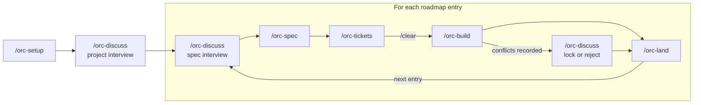

# orc

Orc is a set of eight Claude Code slash commands that sits beside Matt Pocock's agent skills ([`mattpocock/skills`](https://github.com/mattpocock/skills), called upstream in these docs). Upstream already covers the core loop well: grilling a design, writing a spec, splitting it into tickets, building with TDD and reviewing. Orc adds what tends to go missing once that work spans several days and sessions, and it does so without editing a single upstream file.

| Orc adds | So that |
|---|---|
| A registry of requirement and decision ids (`REQ-01`, `D-03`) | specs, tickets and commits can cite what was decided, and a change of mind never rewrites history |
| A `Refs:` trailer on every commit that implements a ticket | a requirement can be traced to the commits that deliver it |
| One named command per step, each opening with a banner and ending with a pointer | you always see what a step is about to run, write and push, and what comes next |
| A status command that reads git and the tracker and stores nothing | a crash, a `/clear` or a new day loses no state |
| Interviews that ask closed questions through Claude Code's native picker | answering is a keypress and the recommended answer is always first |
| A landing step with three modes | a spec gets as much ceremony as it needs, from a local merge to a reviewed PR |

What it deliberately leaves out: orc has no execution engine, event log, state file or merge queue of its own. Each step command briefs the upstream skill that does the work and then follows it. It supports Claude Code only, with GitHub Issues or local markdown files as the tracker, and it never creates or edits `CLAUDE.md` or `AGENTS.md`.

> **Status: early release (0.1.0).** The status script is covered by an automated test suite, while the commands themselves have been exercised mostly in scripted headless Claude Code sessions, where a script answers the pickers. Interactive use may still show rough edges, such as how a picker reads at a glance. If you hit one, please [open an issue](https://github.com/Siddharth-Khattar/orchestra/issues).

## The flow



`/orc` shows where everything stands at any point, and `/orc-next` proposes the next step and runs it once you confirm. The interview, the spec and the tickets are meant to share one session, while the build starts in a fresh one: the pointer each command prints tells you which.

## Requirements

- Claude Code and `git`.
- Node 24.3.0 or newer, for orc's status script, which runs directly on Node's type stripping. That also covers the `skills` CLI that installs orc, which needs Node 22.20 or newer.
- An authenticated `gh`, only if you use the GitHub Issues tracker or one of the two PR landing modes.

## Install

Run the first line from the root of the repo you want to use orc in, then start Claude Code there and run setup:

```
npx skills@1 add Siddharth-Khattar/orchestra -a claude-code --copy -y
/orc-setup
```

The first line copies orc's eight skills into `.claude/skills/`. `/orc-setup` then vendors the upstream skills next to them at one pinned commit, asks for a tracker, a profile and your test command, and writes orc's config and rules. It ends by offering one commit of everything it wrote, which is worth taking, since the build works in git worktrees and a worktree only sees committed files.

From there, the [guide](docs/guide.md) walks one change from an empty repo to a landed merge.

## Commands

| Command | GSD equivalent | Wraps upstream | What it does |
|---|---|---|---|
| `/orc-setup` | new-project (tooling part) | `setup-matt-pocock-skills` | Vendors upstream, writes config and rules. Run again to update |
| `/orc-discuss [spec]` | new-project interview, discuss-phase | `grilling`, `domain-modeling` | Picker interview, then locks ids into the registry |
| `/orc-spec [spec]` | spec-phase | `to-spec` | Writes the spec to the tracker |
| `/orc-tickets [spec]` | plan-phase | `to-tickets` | Splits the spec into tickets with blocking edges |
| `/orc-build [spec or ticket]` | execute-phase | `implement-spec`, `implement` | Builds the spec, or one ticket, on the spec branch |
| `/orc-land [spec]` | ship | `pr` (PR modes) | Lands the spec branch in the chosen mode |
| `/orc [spec]` | progress | none | Status. Read-only |
| `/orc-next` | next | none | Proposes the next step in a picker, then runs it |

The GSD column is there for anyone coming from GSD. With no argument a step command acts on the active spec, the first roadmap entry that is neither dropped nor finished.

Every command opens with a banner before it touches anything and ends with a pointer to the next step. This is `/orc-build` in a repo with two tickets waiting:

```
/orc-build  (GSD: execute-phase)
Runs:    upstream implement-spec or implement, with tdd and code-review, at their locked commits
Target:  memo-cli (none given: the active spec)
Reads:   orc's verdict, the spec, its tickets, the registry lines they cite
Writes:  code and tests on spec/<name>, every commit with its ticket's Refs: trailer
Outward: none (no push, no PR; /orc-land lands the branch); GitHub, whatever push says: built labels and the pending-decisions comment
```

The same run ended with:

```
Done. Next: /orc-discuss memo-cli   (every ticket is built; 1 decision to lock first)
```

## Documentation

| Page | Read it when you want to |
|---|---|
| [Guide](docs/guide.md) | follow one change from install to a landed merge, with what you see at each step |
| [Commands](docs/commands.md) | look up what a command runs, reads, writes, pushes and asks |
| [Concepts](docs/concepts.md) | understand the registry, entry states, trackers, landing modes, pending decisions and trailers |
| [Configuration](docs/configuration.md) | change a profile, the push setting or the test command, or update orc and upstream |
| [Troubleshooting](docs/troubleshooting.md) | know why a command stopped and what to do about it, and where v1's limits are |
| [How it works](docs/how-it-works.md) | review the design as a maintainer or a security-minded adopter: the status script, the verdict, the permission hook |
| [Specification](docs/spec.md) | check the exhaustive detail behind any of the above |

## Development

The skills live in `skills/`, and only that folder is installed into a target repo. The status script, `skills/orc/status.mts`, is dependency-free TypeScript that Node runs directly.

```
npm install
npm test
npm run typecheck
```

`npm test` takes about two minutes, since most tests build real git repositories. [How it works](docs/how-it-works.md#testing-and-budgets) says what the two test files guarantee.

## License

Orc is released under the [MIT License](LICENSE). It does not ship upstream's skills, which `/orc-setup` fetches into your repo: those are Matt Pocock's and carry their own license.
