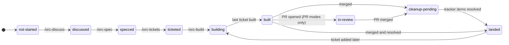
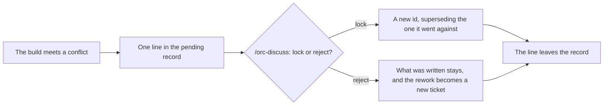
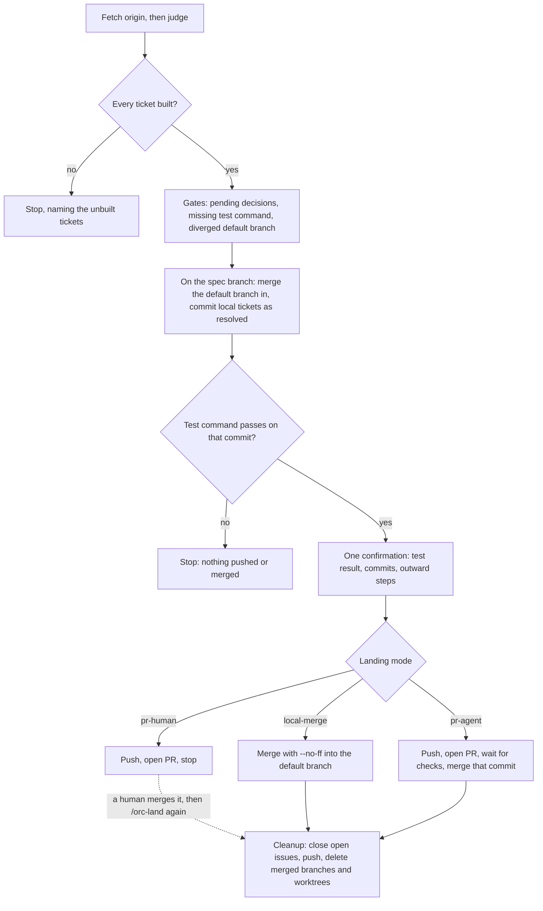

# Concepts

The handful of ideas you meet when using orc, each in the place you would look for it.

- [The registry](#the-registry)
- [Entry states](#entry-states)
- [Trailers and traceability](#trailers-and-traceability)
- [Trackers](#trackers)
- [Pending decisions and assumptions](#pending-decisions-and-assumptions)
- [Landing modes](#landing-modes)
- [What orc writes in your repo](#what-orc-writes-in-your-repo)

## The registry

`docs/orc/registry.md` is an index. It holds one line per requirement and decision, each with an id, a one-line gist and a pointer to where the detail lives, followed by the roadmap. It never holds the detail itself, and it never holds status. An excerpt from a real one, with the gists shortened:

```markdown
## Requirements
- REQ-01: `memo add <text...>` appends its arguments, joined by spaces, as one line to `.memo.txt` (spec: memo-cli)
- REQ-05: When `.memo.txt` does not end with a newline, `memo add` writes one first (spec: memo-cli)
- REQ-11: When `.memo.txt` is non-empty and does not end with a newline, `memo add` writes one first (supersedes REQ-05) (spec: memo-cli)

## Decisions
- D-02: Memos are stored as plain text, one per line, in `.memo.txt` in the current directory -> project

## Roadmap
1. memo-cli
   - Seams: spawned `bin/memo.js` in a temp dir (D-05), asserting stdout, stderr, exit code and `.memo.txt`
   - Landing: local-merge
   - Spec: .scratch/memo-cli/spec.md
   - Branch: spec/memo-cli
```

| Line | Shape | Notes |
|---|---|---|
| Requirement | `- REQ-<n>: <gist> (spec: <entry>, <entry>)` | names the roadmap entries that deliver it |
| Decision | `- D-<n>: <gist> -> <link>` | the link is `project` (holds for every spec), `spec <entry>`, an ADR path `docs/adr/NNNN-<slug>.md`, or `wayfinder <ticket>` (a decision the project interview read from a wayfinder map, which holds for every spec like `project`). A spec interview that reads a map writes `- D-<n>: <gist> (wayfinder <ref>) -> spec <entry>` |
| Correction | `... (supersedes <id>) ...` after the gist | the old line stays, and no longer applies |
| Roadmap entry | `<n>. <name>` | a short, unique kebab-case name, since it becomes a path and a branch |
| Entry field | `   - <Field>: <value>` | `Seams`, `Landing`, `Spec`, `Branch`, `Delivers`, `Dropped` |

Three rules keep it trustworthy:

- **Ids are append-only.** An id has at least two digits and is never edited, renumbered or reused. A change of mind is a new id that supersedes the old one, so everything that cited the old id still points at a real line.
- **Roadmap entries are never renumbered, reordered, renamed or removed.** New ones go at the end, and the order is the build order. An entry taken out of the plan gets a `Dropped:` line and is skipped from then on.
- **Only `/orc-discuss` writes ids, and only on the default branch.** `/orc-spec` adds an entry's `Spec:` and `Branch:` lines. Before either command commits its registry edit, the run asks the status script whether any line that was already committed has changed or moved, and it has to answer `unchanged`. Two commits have nothing to check and skip it: the project interview's, since no registry was committed before, and an `/orc-spec` rerun that only commits the lines an earlier run left behind.

Only registry ids carry authority. A spec, a ticket or a brief cites ids, and an implementer follows the lines it was given. To see a line without opening the file:

```
$ node .claude/skills/orc/status.mts registry memo-cli REQ-05 D-99
1. memo-cli
   - Seams: spawned `bin/memo.js` in a temp dir (D-05), asserting stdout, stderr, exit code and `.memo.txt`; no internal module tests
   - Landing: local-merge
   - Spec: .scratch/memo-cli/spec.md
   - Branch: spec/memo-cli
- REQ-05: When `.memo.txt` does not end with a newline, `memo add` writes one first, so every memo is written as `<text>\n` on its own line (spec: memo-cli) (superseded by REQ-11)
D-99: not in the registry
```

## Entry states

Orc stores no progress anywhere. Each time a command runs, the status script works out every entry's state from three sources: the registry lines, git (branches and `Refs:` trailers) and the tracker.



The diagram follows the main flow, so three states from the table below are not drawn: `squashed`, `unknown` and `dropped`. An entry can end up in any of them from several places, and none of them leads on to a next step by itself.

| State | What the script saw | Next |
|---|---|---|
| `not-started` | the entry has no `Landing:` line | `/orc-discuss <name>` |
| `discussed` | a `Landing:` line, no `Spec:` line | `/orc-spec <name>`, in the interview's session |
| `specced` | a `Spec:` line, no tickets | `/orc-tickets <name>` |
| `ticketed` | tickets, none of them built | `/orc-build <name>`, after `/clear` |
| `building` | some tickets built | `/orc-build <name>` |
| `built` | every ticket built, no open PR | `/orc-land <name>`, or `/orc-discuss <name>` first when decisions are pending |
| `in-review` | every ticket built, an open PR | `/orc-land <name>`; in `pr-human` a wait for the review |
| `cleanup-pending` | landed, but tracker items are still open | `/orc-land <name>` |
| `landed` | landed and every tracker item resolved | the next entry's step |
| `squashed` | the branch was squashed or rebased onto the default branch | check the landing by hand |
| `unknown` | a lookup failed, or a merged PR's merge commit is not fetched yet | fix what the note names; for the PR, `/orc-land <name>` |
| `dropped` | a `Dropped:` line | skipped |

The definitions behind those rows:

- A ticket is **built** once a commit on `spec/<name>` (or `origin/spec/<name>`) that the default branch does not hold carries its `Refs:` trailer. Labels and `Status:` lines play no part.
- A ticket has **landed** once a commit carrying its trailer is reachable from the default branch, locally or on `origin` as last fetched, and no commit on the spec branch that has yet to land carries it. Rework on a landed ticket therefore reads as built until it lands too.
- An entry has landed when it has a spec, at least one ticket, and every ticket has landed. It is finished when its tracker items are resolved too: the issues closed, or the files' `Status:` reading `resolved`.
- The **active spec** is the first entry that is neither dropped nor finished.

Since a landed ticket counts as built, adding a ticket to a landed entry simply makes it `building` again.

## Trailers and traceability

Every commit that implements a ticket ends with a trailer naming it: `Refs: #40` on GitHub, `Refs: memo-cli/02` with local markdown. A review fix that spans tickets carries one line per ticket. They all sit in the message's last paragraph, since that is the only place git reads trailers from.

<p align="center">
  
  
</p>

So the question "which commits deliver `REQ-03`?" is a join: the tickets whose `Satisfies:` line holds the id, then the commits whose trailer names those tickets. This is also why orc lands with merge commits only. A squash or a rebase would replace the per-ticket commits, the join would break, and `/orc` reports such an entry as `squashed` instead of passing it off as landed.

Two kinds of commit on a spec branch need no trailer: merges, and **record commits**, which only change files under `.scratch/<name>/` (ticket status marks, the pending record, exploration notes). Anything else without one shows up in `/orc` as an untrailed commit.

## Trackers

One tracker per repo, chosen at setup and fixed once any entry has a spec.

| | GitHub Issues | Local markdown |
|---|---|---|
| Spec | an issue whose title starts with `<name>: ` | `.scratch/<name>/spec.md` |
| Tickets | sub-issues of the spec issue, with GitHub's blocking edges | `.scratch/<name>/issues/<NN>-<slug>.md`, with a `Blocked by:` line |
| Ticket reference | `#<n>` | `<name>/<NN>` |
| Trailer | `Refs: #40` | `Refs: memo-cli/02` |
| Built mark (display only) | the `built` label | `Status: built` |
| Pending decisions | one comment on the spec issue | `.scratch/<name>/pending-decisions.md` on the spec branch |
| Resolved | the issue is closed | `Status:` is `resolved`, `closed` or `done` |
| At landing | a comment on each open issue, which is then closed | `Status:` set to `resolved` in one record commit |
| Before the spec and tickets are created | a picker with the titles, as [`push`](configuration.md#the-push-setting) says | nothing extra: they are files in a commit |
| Needs | an authenticated `gh` and a GitHub `origin` | nothing; the files are committed like everything else |

Tickets stay open until the spec lands. The built marks are only for you to see: the trailers decide.

On GitHub, a spec issue with no sub-issues falls back to the issues whose body says `Part of #<n>`. Anyone can file one of those, so in that fallback an issue only counts as a ticket when its author has write access or a maintainer has added the `orc-ticket` label. The others are ignored issues: `/orc` names them, and they are never built, commented on or closed. Orc can only go by GitHub's author association there (owner, member or collaborator), which in an organisation may be wider than write access to the repo.

## Pending decisions and assumptions

A build sometimes cannot follow everything it was given. A ticket may contradict the spec, or the code may show that a locked decision cannot work as written. Orc separates two cases:

| | Pending decision | Assumption |
|---|---|---|
| When | what was written cannot all hold: the spec, a ticket or a locked id had to be gone against | the spec left a choice open |
| What the implementer does | keeps as much as it can and reports what it went against | makes the choice |
| Where it goes | one line in the entry's pending record | an `Assumptions:` paragraph in the commit message, the build report, and the PR body in the PR modes |
| Who settles it | you, in `/orc-discuss <name>`: lock it as a new id, or reject it | nobody: it is reported, never gated |

The pending record is a marker line followed by one line per conflict:

```
<!-- orc:pending-decisions -->
- memo-cli/02: an existing zero-byte `.memo.txt` gets no leading newline, so the new memo is memo 1, following the spec's Implementation Decisions ("non-empty") and the ticket, against REQ-05
```

With the local tracker it is `.scratch/<name>/pending-decisions.md`, committed on the spec branch. On GitHub it is one comment on the spec issue, and only a comment by an author with write access counts. A pending line has no authority: nothing cites it, and an implementer that sees one reads it as what the build already did.



`/orc` shows the count ("1 decision to lock"), and `/orc-discuss <name>` walks through the lines. Locking one writes a new id, superseding the id it went against when it names one. Rejecting one keeps what was written, and the rework becomes a new ticket. Either way the line leaves the record, and an empty record is deleted. `/orc-land` asks before landing with lines still pending.

## Landing modes

Each entry lands in one of three modes. The profile sets the default, and the spec interview lets you choose per entry (the `Landing:` line).

| Mode | What `/orc-land` does | You wait for |
|---|---|---|
| `local-merge` | merges the spec branch into the default branch with a merge commit and pushes as `push` says | nothing |
| `pr-agent` | pushes the branch, opens a PR, waits for the checks on the commit it tested, merges exactly that commit | nothing |
| `pr-human` | pushes the branch, opens the PR ready for review, stops | the review, then `/orc-land` again |



What holds in every mode:

- **Merge commits only.** Orc never squashes, rebases, resets or force-pushes, and never uses GitHub's auto-merge.
- **No partial landing.** An entry with an unbuilt ticket does not land.
- **What was tested is what lands.** The default branch is merged into the spec branch first, the tests run on that commit, and only that commit is merged. `pr-agent` merges with `--match-head-commit`, so a push by someone else in between stops it.
- **A failed test run or check stops the run**, and so does CI that was expected and never reported. On a repo with no workflow files, the local run is the evidence.
- **Branches are deleted only once git shows them merged.** A spec branch holding commits the default branch lacks is left and named.

In `pr-human`, the PR has to be merged with "Create a merge commit". Once it is, `/orc-land` again closes the issues and cleans up.

## What orc writes in your repo

The whole footprint at a glance, with who writes each part. The table below has the detail.

```
your-repo/
├── .claude/
│   ├── skills/
│   │   ├── orc*/                the install command: orc's skills, status script, hook, templates
│   │   └── <name>/              setup: upstream's skills, unmodified
│   ├── rules/
│   │   ├── orc.md               setup
│   │   └── agent-skills.md      setup, on upstream's behalf
│   ├── settings.json            setup: one key merged in
│   └── worktrees/               build: implementer worktrees, ignored by git, removed once merged
├── docs/
│   ├── orc/
│   │   ├── config.json          setup
│   │   └── registry.md          discuss, spec
│   ├── agents/                  upstream's setup
│   └── adr/                     upstream domain-modeling, during interviews
├── .scratch/<name>/             local tracker only
│   ├── spec.md                  spec
│   ├── issues/                  tickets; build and land update the Status: lines
│   ├── notes/                   build
│   └── pending-decisions.md     build writes it, discuss resolves it
├── GLOSSARY.md                  upstream domain-modeling, during interviews
├── skills-lock.json             the skills CLI
└── .gitignore                   setup
```

| Path | Written by | Content |
|---|---|---|
| `.claude/skills/orc*/` | the install command | orc's eight skills, the status script, its permission hook and templates |
| `.claude/skills/<name>/` | setup, through the `skills` CLI | upstream's skills, unmodified |
| `skills-lock.json` | the `skills` CLI | source repo, commit and hash of each vendored skill |
| `.claude/rules/orc.md` | setup | orc's rules: the trailer, id citations, pickers, foundations first |
| `.claude/rules/agent-skills.md` | setup, on upstream's behalf | upstream's `## Agent skills` block |
| `.claude/settings.json` | setup | `"attribution": {"commit": "", "pr": "", "sessionUrl": false}` merged in, other keys kept |
| `.gitignore` | setup | `.claude/worktrees/` ignored; `!.scratch/` added with the local tracker when a rule ignores it |
| `docs/orc/config.json` | setup | [the configuration](configuration.md) |
| `docs/orc/registry.md` | discuss, spec | the registry |
| `docs/agents/*.md` | upstream's setup | tracker and domain docs for upstream's skills |
| `GLOSSARY.md`, `docs/adr/` | upstream `domain-modeling`, during interviews | the glossary and ADRs that decisions link to |
| `.scratch/<name>/` | spec, tickets, build, discuss, land (local tracker) | `spec.md`, `issues/`, `notes/`, `pending-decisions.md` |

All of it is meant to be committed. On GitHub orc also writes the spec and ticket issues, the `built` and `orc-ticket` labels, one pending-decisions comment per spec issue, and PRs in the PR modes. During a build, implementer worktrees live under `.claude/worktrees/` and their branches are named `worktree-agent-*`; both are removed once merged.

What orc never touches:

- `CLAUDE.md` and `AGENTS.md` are never created or edited, by orc or by upstream's setup when it runs through `/orc-setup`. The block upstream would put there goes into `.claude/rules/agent-skills.md`, which Claude Code loads in every session as well.
- Vendored upstream skill files are never edited, so an update is a clean overwrite.
- Your history: no squash, rebase, reset or force-push, and a worktree that holds files is never removed without showing you what is in it.

---

[Back to the README](../README.md#documentation) · Next: [Configuration](configuration.md)
