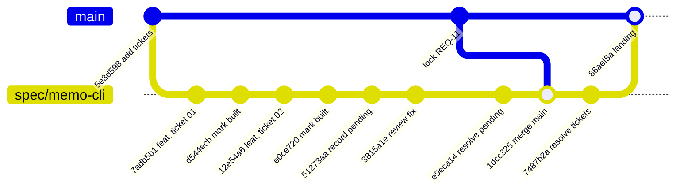

# Guide: from an empty repo to a landed change

This walk-through follows one real run: a tiny CLI called `memo`, built in a repo that held nothing but a README. It used the local markdown tracker and the hackathon profile, so there is no GitHub in it; [the last section](#what-changes-on-github) says what differs when there is. Everything quoted below is what the commands printed or asked, shortened where it ran long.

The whole run is eight commands, and the sections below carry the same numbers:

| Step | Command | Session | Leaves behind |
|---|---|---|---|
| 1 | `/orc-setup` | any | upstream skills, config, rules: one commit |
| 2 | `/orc-discuss` | A | the registry: requirements, decisions, roadmap |
| 3 | `/orc-discuss memo-cli` | B | the entry's decisions, seams and landing mode |
| 4 | `/orc-spec` | B | the spec |
| 5 | `/orc-tickets` | B | the tickets |
| 6 | `/orc-build` | C, after `/clear` | code on `spec/memo-cli`, one pending decision |
| 7 | `/orc-discuss memo-cli` | D | the pending decision locked as a new id |
| 8 | `/orc-land` | D | the merge on `main`, tickets resolved |

If you would rather not remember the order, type `/orc` at any point: it prints where things stand and the next command.

## 1. Install and set up

From the repo root:

```
npx skills@1 add Siddharth-Khattar/orchestra -a claude-code --copy -y
```

That copies orc's eight skills into `.claude/skills/`. Start Claude Code in the same directory and run `/orc-setup`. It has to be started at the checkout root, since that is where setup writes its files.

Setup asks four things in one picker:

| Question | What was offered here | Answer |
|---|---|---|
| Tracker | Local markdown (recommended, as the remote is not on GitHub), GitHub Issues | Local markdown |
| Profile | hackathon (recommended), mvp, production, each with the defaults it sets | hackathon |
| Extras | Core only (recommended), Choose extras | Core only |
| Test command | None for now, Type one | `npm test`, typed in |

It then clones upstream, vendors its thirteen core skills at that clone's commit, and runs upstream's own setup with the tracker already answered. Before anything from that is written you get the full draft inside a picker ("Write as drafted" or "Edit first"). The last question lists every path setup created and offers to commit them:

```
Commit them as "chore: set up orc and upstream skills"?
  Commit the setup files (Recommended)
  Leave them uncommitted
```

Take the commit. `/orc-build` refuses to start while these paths are uncommitted. Setup ends with:

```
Done. Next: /orc-discuss   (project interview: requirements, architecture, roadmap)
```

## 2. The project interview

`/orc-discuss` in a repo with no registry runs the project interview, once. It first asks whether the project is clear enough for one interview or should be charted with upstream's `/wayfinder` first, and then works through rounds of questions. Closed questions arrive in the picker, up to four at a time, with the recommended answer first. You can always type your own answer instead:

| Question | Recommended | Answered |
|---|---|---|
| Stack | TypeScript on Node | "Plain ESM JavaScript on Node 24, not TypeScript. No build step, no runtime or dev dependencies." |
| Storage | One JSON file | "Plain text, not JSON: one memo per line in `.memo.txt`" |
| Tests | node:test, run the CLI | the recommendation |
| Roadmap | project-setup, then add-memo | "One entry is enough for a project this small: a single roadmap entry named `memo-cli`" |

Nothing is written during the rounds. When the questions run out, the complete proposal comes back inside one picker, as the exact lines that would go into the registry, with "Lock and commit (Recommended)" or "Change something first". After the lock, `docs/orc/registry.md` held this:

```markdown
## Requirements

- REQ-01: `memo add <text...>` appends its arguments, joined by spaces, as one line to `.memo.txt` in the current directory, creating the file if missing (spec: memo-cli)
- REQ-02: `memo add` prints `Added memo <n>`, where n is the memo's 1-based line number (spec: memo-cli)
...

## Decisions

- D-01: Plain ESM JavaScript on Node 24: no TypeScript, no build step, no runtime or dev dependencies -> project
- D-02: Memos are stored as plain text, one per line, in `.memo.txt` in the current directory -> project
...

## Roadmap

1. memo-cli
```

The commit is `docs: lock project requirements, decisions and roadmap`. Since the `push` setting starts at `ask`, a second picker shows the unpushed commits and offers "Push (Recommended)" or "Don't push". Every docs commit from here on ends the same way.

## 3. The spec interview

Each roadmap entry gets its own, shorter interview: `/orc-discuss memo-cli`. The locked ids are treated as settled, so the questions are about what this entry still leaves open (here: a file without a trailing newline, trimming, carriage returns, exact error text, blank lines). It also settles two things of its own:

- **Seams**: where the tests attach. Answered "CLI process only".
- **Landing**: `local-merge`, `pr-agent` or `pr-human`, the config's default first. Answered `local-merge`.

The lock added `REQ-05` to `REQ-10` and two lines under the entry:

```markdown
1. memo-cli
   - Seams: spawned `bin/memo.js` in a temp dir (D-05), asserting stdout, stderr, exit code and `.memo.txt`; no internal module tests
   - Landing: local-merge
```

A `Landing:` line is what marks an entry as discussed. The pointer now reads:

```
Done. Next: /orc-spec memo-cli   (memo-cli is discussed, no spec yet; run it in the interview's session)
```

## 4. The spec, in the same session

The pointer asks you to stay in the session because upstream's `to-spec` synthesises the spec from the conversation you have just had. `/orc-spec` wrote `.scratch/memo-cli/spec.md`, which opens with the ids it relies on:

```markdown
# memo-cli

Registry: REQ-01, REQ-02, REQ-03, REQ-04, REQ-05, REQ-06, REQ-07, REQ-08, REQ-09, REQ-10, D-01, D-02, D-03, D-04, D-05, D-06, D-07
```

It also recorded the spec on the roadmap entry (`Spec:` and `Branch: spec/memo-cli`) and committed both as `docs: add memo-cli spec`. Three things the registry did not settle went under the spec's Further Notes as open questions instead of being decided silently. One of them comes back during the build, in step 6.

## 5. The tickets

Still in that session, `/orc-tickets` drafted a breakdown and put all of it in one picker: "Approve (Recommended)", "Too coarse", "Too fine" or "Change something". The first draft had three tickets; the answer was "Too fine", two were merged, and the second draft was approved. Each ticket file carries the ids it covers and its blockers:

```markdown
Satisfies: REQ-01, REQ-02, REQ-03, REQ-05, REQ-06, REQ-07, REQ-08, REQ-09, REQ-10, D-02, D-03

**Blocked by:** 01 (Package, test harness and usage line)
```

`/orc` now shows the entry ready to build:

```text
Docs: the working tree
Roadmap:
  1. memo-cli  ticketed, 0 of 2 tickets built
Target: memo-cli, branch spec/memo-cli
State: ticketed, 0 of 2 tickets built
Landing: local-merge (the entry's Landing: line)
Delivers: REQ-01 REQ-02 REQ-03 REQ-04 REQ-05 REQ-06 REQ-07 REQ-08 REQ-09 REQ-10
Tickets: 0 landed, 0 built, 0 in progress, 2 open, of 2
  memo-cli/01 ready
  memo-cli/02 blocked (waiting on memo-cli/01)
Off the main flow, ask upstream's /ask-matt.
```
```
Done. Next: /orc-build memo-cli   (2 of 2 tickets to build; start it after /clear)
```

## 6. Build, in a fresh session

After `/clear`, `/orc-build` needs nothing from the earlier conversation: the spec, the tickets and the registry lines they cite are all on disk. It normally asks before it starts, showing the branch it will use and the tickets it will build. The hackathon profile sets `buildStart` to `always`, so here it printed that and went ahead.

What the run did, in order:

1. Created `spec/memo-cli` from `main`.
2. Handed ticket 01 to an implementer subagent in its own worktree, with only the registry lines that ticket cites. Merged its commit into `spec/memo-cli`, ran `npm test`, removed the worktree, and marked the ticket built.
3. Did the same for ticket 02, which had been waiting on 01.
4. Recorded one pending decision (below).
5. Ran upstream's `code-review` on the branch and one fix round, the cap this profile sets.

The branch afterwards:

```
* 3815a1e refactor: clarify memo number and make the CLI executable
* 51273aa docs: record memo-cli pending decisions
* e0ce720 docs: mark memo-cli tickets built
* 12e54a6 feat: add memo add command
* d544ecb docs: mark memo-cli tickets built
* 7adb5b1 feat: add memo package, test harness and usage line
* 5e8d598 docs: add memo-cli tickets
```

Every commit that implements a ticket ends with a `Refs:` trailer, and that trailer is the only thing orc counts as "built". The review fix touched both tickets, so it carries two:

```
refactor: clarify memo number and make the CLI executable

Refs: memo-cli/01
Refs: memo-cli/02
```

The `docs:` commits in between are record commits. They only touch files under `.scratch/memo-cli/` and need no trailer. Concepts has a [figure of the whole chain](concepts.md#trailers-and-traceability) for this run, from `REQ-01` to the landing merge.

**The pending decision.** `REQ-05` said a newline is written first whenever `.memo.txt` does not end with one. The spec and the ticket said "non-empty file". For a zero-byte file those cannot both hold, so the implementer followed the spec and the ticket and reported what it went against. Orc wrote that down instead of deciding it:

```
<!-- orc:pending-decisions -->
- memo-cli/02: an existing zero-byte `.memo.txt` gets no leading newline, so the new memo is memo 1, following the spec's Implementation Decisions ("non-empty") and the ticket, against REQ-05
```

Choices the spec simply left open are different. Those are assumptions: the implementer makes them, lists them in its commit message under `Assumptions:`, and the build report repeats them, but nothing waits on them.

The run's report listed the tickets with their commits, the review findings it fixed and the ones it left, the pending line and the assumptions, and ended on `main` with:

```
Done. Next: /orc-discuss memo-cli   (every ticket is built; 1 decision to lock first)
```

## 7. Lock the pending decision

`/orc-discuss memo-cli` on a built entry opens with the pending lines, each as its own question with up to four per picker call: "Lock it as a new id (Recommended)" or "Reject it". Locking it produced a new requirement that supersedes the old one. The old line stays exactly as it was:

```markdown
- REQ-05: When `.memo.txt` does not end with a newline, `memo add` writes one first, so every memo is written as `<text>\n` on its own line (spec: memo-cli)
...
- REQ-11: When `.memo.txt` is non-empty and does not end with a newline, `memo add` writes one first, so every memo is written as `<text>\n` on its own line; an empty file's first memo is memo 1 (supersedes REQ-05) (spec: memo-cli)
```

Rejecting would have kept `REQ-05` as written, and the rework would have become a new ticket through `/orc-tickets memo-cli`. You can also skip this step: `/orc-land` asks about pending lines and lets you land anyway.

## 8. Land

`/orc-land` (here run through `/orc-next`, which showed the same banner in its own picker first) prepares the branch before it asks anything: it merges `main` into `spec/memo-cli`, sets the tickets' `Status:` lines to resolved in one more record commit, and runs the test command on the result. Then comes the one confirmation, with everything you need to judge in the question:

```
Target:  memo-cli (roadmap entry 1), spec .scratch/memo-cli/spec.md
Mode:    local-merge (the entry's Landing: line)
State:   built

Tested:  npm test passed on 7487b2a (16/16)
main was merged into spec/memo-cli first (1dcc325).

Commits to land (main..spec/memo-cli), resolving memo-cli/01 and memo-cli/02:
7487b2a docs: resolve memo-cli tickets
1dcc325 Merge branch 'main' into spec/memo-cli
e9eca14 docs: resolve memo-cli pending decisions
3815a1e refactor: clarify memo number and make the CLI executable
...

Outward steps: merge spec/memo-cli into main with --no-ff; push main to origin (with the push option).

  Merge and push (Recommended)
  Merge locally only
  Stop
```

"Merge and push" made the merge commit `86aef5a` on `main`, pushed it, and deleted the local `spec/memo-cli`, which git now showed as merged.

Put together, the history from the tickets commit to the landing looks like this. The commits on `spec/memo-cli` up to `3815a1e` are the build from step 6, and the commit on `main` beside them is the lock from step 7:



## Afterwards

```text
Docs: the working tree
Roadmap:
  1. memo-cli  landed
Off the main flow, ask upstream's /ask-matt.
```
```
Done. Next: /orc-discuss   (add the next roadmap entry)
```

Nothing recorded that state. `/orc` worked it out from the registry, the ticket files and the trailers reachable from `main`, which is why it gives the same answer in any session, on any clone.

To carry on, `/orc-discuss <new-name>` offers to add the entry at the end of the roadmap, and the cycle from step 3 repeats.

## What changes on GitHub

With the GitHub Issues tracker and a PR landing mode the commands are the same, while the spec, the tickets and the pending record move from files under `.scratch/` to issues. The [tracker table in Concepts](concepts.md#trackers) lists every difference side by side. For this run it would have meant:

- the spec recorded by its issue number, as in `Spec: #37`, instead of a path, and trailers reading `Refs: #40` where this run had `Refs: memo-cli/02`;
- a picker with the issue titles before `/orc-spec` and `/orc-tickets` create anything, as `push` says;
- the pending decision kept as one comment on the spec issue, and the tickets closed with a comment at landing instead of getting a `Status:` line.

In `pr-agent` mode `/orc-land` pushes the branch, opens the PR, waits for the checks on the commit it tested and merges that commit. In `pr-human` it opens the PR and stops; once someone has merged it with a merge commit, `/orc-land` again finishes the entry. [Concepts](concepts.md#landing-modes) has the details.

---

[Back to the README](../README.md#documentation) · Next: [Commands](commands.md)
