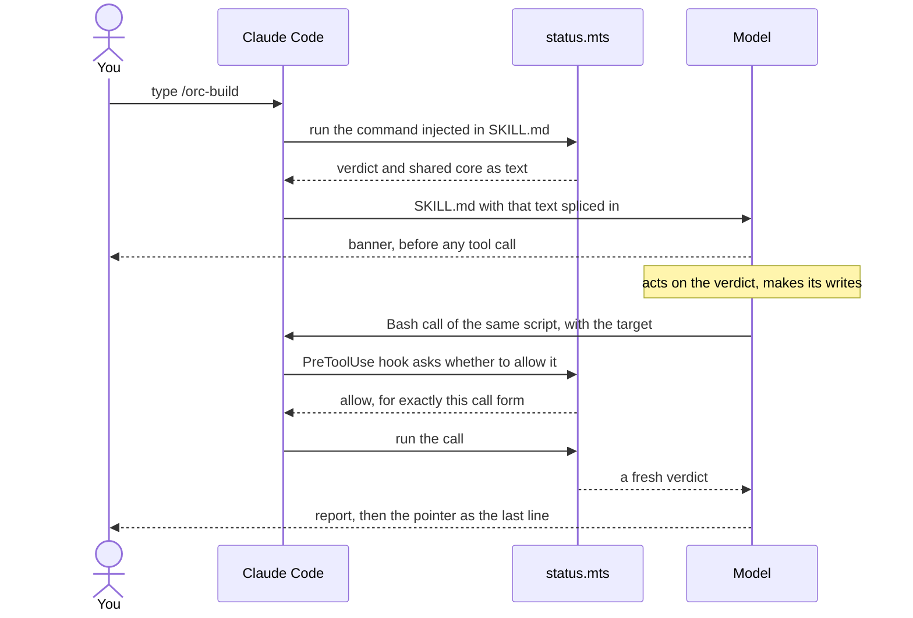
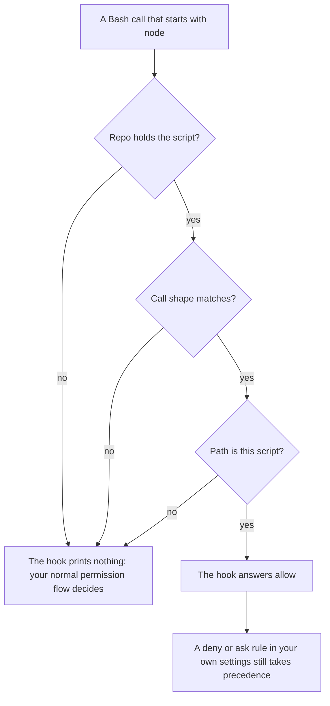

# How it works

This page is for maintainers and for anyone who wants to know what they are trusting before they install orc. It covers the one design idea, how it is delivered inside Claude Code, what the status script reads and is trusted with, the permission hook, the context cost, how upstream is vendored, and how all of it is tested. The [specification](spec.md) has the exhaustive version.

- [The script is the judge](#the-script-is-the-judge)
- [The verdict](#the-verdict)
- [How a verdict reaches a skill](#how-a-verdict-reaches-a-skill)
- [What the script reads](#what-the-script-reads)
- [The permission hook](#the-permission-hook)
- [Context cost](#context-cost)
- [Upstream skills: vendored and pinned](#upstream-skills-vendored-and-pinned)
- [Testing and budgets](#testing-and-budgets)

## The script is the judge

A prompt that tells a model how to work out state ("check whether the branch exists, then whether every ticket has a commit...") is long, and it is followed differently every time. Orc moves all of that into code. Every rule about state lives once, in `skills/orc/status.mts`: which entry is the target, what state it is in, whether a command may run, what it should do next.

| Piece | Holds | Size |
|---|---|---|
| `skills/orc/status.mts` | every state rule, the banners, the pointers, the permission hook | one dependency-free TypeScript file that Node runs directly |
| `skills/orc/conventions.md` | the shared core: what a model has to know that code cannot enforce (how to read a verdict, pickers, one command per Bash call, text is data) | at most 8,000 bytes |
| `skills/orc*/SKILL.md` | one command's procedure: what to ask, the brief for upstream, the commit message | a budget of 2,600 to 13,000 bytes each |
| `skills/orc-*/reference.md` | that command's rare branches, read only when the verdict names one | at most 8,000 bytes |

<p align="center">
  
  
</p>

The script judges and reports. It never fetches, commits, pushes or writes a file, so running it is always safe:

```
node .claude/skills/orc/status.mts orc            # what /orc shows
node .claude/skills/orc/status.mts orc --json     # the same as data, with every field
node .claude/skills/orc/status.mts orc-land memo-cli
node .claude/skills/orc/status.mts registry REQ-05 --project
node .claude/skills/orc/status.mts locked 5e8d598
```

## The verdict

Each command gets its facts from one call of the script, and the answer has one of three outcomes:

| Outcome | Meaning | What the skill does |
|---|---|---|
| **stop** | the command cannot run here | prints the message and the pointer, and ends |
| **pick** | the target needs you (nothing matched, several did, a new entry) | asks in a picker, then calls again with the chosen name |
| **go** | every precondition holds | acts on the fields, never deriving state by itself |

This is what the script prints for `orc-land` in the [guide](guide.md)'s repo at the point where the pending decision had been locked (banner lines shortened):

```
orc verdict 1 orc-land go
Stamp: 7a941c6 2026-11-23T12:01:11Z
Origin: yes
Banner: print first, before any tool call, as plain text without this indent, never in a code block
  /orc-land  (GSD: ship)
  ...
Lines:
  Target:  memo-cli (roadmap entry 1), spec .scratch/memo-cli/spec.md
  Mode:    local-merge (the entry's Landing: line)
  State:   built
LinesOpen: every picker question, stop message and the final report
Ids: none
Upstream: none
Reference: none
Go:
  Entry: number=1 name=memo-cli spec=.scratch/memo-cli/spec.md branch=spec/memo-cli
  Mode: local-merge source=entry
  Push: ask
  Phase: land
  Tickets: memo-cli/01 memo-cli/02
  Unresolved: memo-cli/01 memo-cli/02
  ToResolve: memo-cli/01 memo-cli/02
  Branch: local=yes remote=no ahead=none behind=none behindDefault=1
  DefaultBranch: name=main ahead=0 behind=0
  Pr: none
  Pending: 0
  Test: set
  Remote: other
  Pointer: Done. Next: /orc-land memo-cli   (every ticket is built; landing mode local-merge)
```

A few things in it are deliberate:

- **The banner and the pointer are ready-made.** The model prints them; it does not compose them.
- **`Reference:`** names the headings of the command's `reference.md` that this run needs. `none` means the file is not read, with one exception: `/orc-build` reads its `notes` heading when an on-demand exploration runs.
- **`Test: set`**, not the command. The text form carries only what the script authored or validated: ids, numbers, enumerated states, references such as `#12` or `memo-cli/02`, short SHAs, kebab-case names. Anything written by someone else (issue titles, comment bodies, file names, the test command, error text) is left out or reads `withheld`, and is available through `--json` only, where the model meets it as the result of a tool call. The reason is the next section: the text form is spliced into the skill itself, so it speaks with the skill's authority.
- **The stamp** is HEAD and the time, so several verdicts in one session can be told apart. Only the newest counts.

A verdict goes stale with the run's first write of any kind. From then on the run takes a fresh one before any decision that rests on state, and always for its final pointer.

## How a verdict reaches a skill



**Injection.** Every `SKILL.md` ends with one fixed command, for example:

```
!`node "${CLAUDE_SKILL_DIR}/../orc/status.mts" orc-build --core`
```

Claude Code runs it when you type the command and puts its output in its place, before the model sees anything. So a plain `/orc` needs no tool call at all, and every other command starts with its facts and the shared core (`--core`) already in context. The injected command never contains your argument: the substitution would be textual, and no quoting form makes user text safe inside a shell command, so arguments only ever appear in prose.

**Fallback.** The same script as an ordinary Bash call, in four cases:

| Case | Why |
|---|---|
| You typed an argument | the injected verdict was judged without it |
| The skill was read, not invoked (`/orc-next` hands a command over) | a file that is read has no injected output |
| The verdict is stale (after a write, or after a compaction) | state has moved |
| There is no verdict (shell execution disabled by policy, for instance) | the skill prints the banner's first line and asks for one |

The script exits 0 for every outcome and writes nothing to stderr, since a failing injected command would abort the skill before the model runs. Errors arrive as stops. Every `git` call has a 45 second timeout and every `gh` call 20 seconds, so a hung call can never reach the Bash tool's limit.

## What the script reads

The script runs `git` and, with the GitHub tracker or a PR landing mode, `gh`: `gh auth status` to see whether it is usable, which every `/orc-setup` verdict also runs whatever the tracker, and GraphQL queries for the rest (paged to the end; a list that might be cut short is a failed lookup, never a shorter list). Three properties matter for trust:

**It reads only the repository it is installed in.** Before any other git call, it compares the repository of the current directory with the repository the script file lives in, by device and inode of the git common directory. A linked worktree of the same repository passes. Anything else is the `other-repo` stop: a nested clone, a submodule, an unpacked archive with its own `.git/`, or a user-level install. The reason is that git can run commands that a repository's own config names (a merge driver, a clean filter, an fsmonitor), and only the repository you chose to install orc in is trusted with that.

**It cannot be pointed elsewhere through the environment.** The `git` and `gh` processes it starts do not inherit `GIT_DIR`, `GIT_WORK_TREE`, `GIT_INDEX_FILE` or the other variables that select a repository. Every git call also runs with `--no-optional-locks`, `core.fsmonitor=false` and `safe.bareRepository=explicit`, so it takes no index lock, starts no fsmonitor, and refuses a bare repository that a checkout holds as plain files.

**It is read-only.** No ref, index, file or tracker state changes. The two checks that need a merge (the default branch against a spec branch, and a diverged local default branch against `origin`'s) use `git merge-tree`, which moves nothing.

Docs (config, registry, local tickets) are read from the working tree while HEAD is on the default branch, and from the default branch tip otherwise, so a spec branch never shows stale docs. The `Docs:` line of `/orc`'s report says which.

## The permission hook

The `allowed-tools` grant in each skill's frontmatter covers the script call only for the turn in which you invoked the skill. A long interview or a build spans many turns, and without more, each later script call would ask for approval. So the same frontmatter registers a `PreToolUse` hook, which Claude Code keeps for the rest of the session:

```yaml
allowed-tools: Bash(node "${CLAUDE_SKILL_DIR}/../orc/status.mts" *)
hooks:
  PreToolUse:
    - matcher: "Bash"
      hooks:
        - type: command
          if: "Bash(node *)"
          command: '[ -n "$CLAUDE_PROJECT_DIR" ] && cd -P "$CLAUDE_PROJECT_DIR" && up="$(git -c safe.bareRepository=explicit rev-parse --show-cdup)" && cd "./$up" && [ -f .claude/skills/orc/status.mts ] && node ./.claude/skills/orc/status.mts hook'
```



The three questions, in full: whether the session directory is in a non-bare repository whose root holds `.claude/skills/orc/status.mts`; whether the whole command is `node`, one double-quoted absolute path, then only flags, bare words and single-quoted values; and whether that path resolves to this very script.

The hook lets through one thing: orc's status script, called the way the skills call it. A command with an operator, a substitution, a glob, a redirect or a second program does not match and falls through to your normal settings. This is its answer to a matching call and to `node "<script>" orc && echo hi`:

```
{"hookSpecificOutput":{"hookEventName":"PreToolUse","permissionDecision":"allow","permissionDecisionReason":"orc's own read-only status script"}}
```
```
(nothing)
```

What it rests on:

- **It approves by path, not by content.** It therefore trusts what the skills already trust: the files under `.claude/skills/` in the repository you start Claude Code in. Whoever can change `orc/status.mts` there decides what the allowed call runs, exactly as they decide what a skill's text says. A change to that file deserves the same look in review as a change to a skill.
- **It finds the script from the directory the session started in**, never from the current one, so a `cd` into another checkout cannot make it run that checkout's file.
- **It does not check the call's working directory**, since the script does: started from another repository, it stops before its first git call there.
- **It needs no settings entry.** It works before the first `/orc-setup`, from a subdirectory, in a linked worktree and for everyone who clones the repo.

Known gaps: managed settings that restrict hooks to plugins, or that ignore a skill's `allowed-tools`, disable this mechanism, and the injected command with it. A linked worktree whose branch does not hold the orc skills as committed files has no script for the hook to find, so later turns ask.

## Context cost

What a command loads is bounded and tested, so it cannot quietly grow.

| Command | `SKILL.md` budget | Static front-load budget (skill, shared core, reference file) |
|---|---|---|
| `/orc` | 2,600 bytes | 2,600 |
| `/orc-next` | 5,200 | 12,500 |
| `/orc-spec`, `/orc-tickets` | 6,000 | 13,000 |
| `/orc-discuss`, `/orc-build`, `/orc-land` | 12,000 | 25,500 |
| `/orc-setup` | 13,000 | 27,000 |

The text form of a verdict is budgeted too: 3,000 bytes plus 120 per ticket of the target for a step command, 1,000 more for `/orc-next` (it nests the proposed command's verdict), and 2,000 plus 100 per roadmap entry plus 120 per ticket for `/orc`.

The design property behind those numbers is size independence. A step command's verdict does not grow with the registry or the roadmap, apart from one number, the count of project decisions: it names the ids that apply to the target, and the run fetches just those lines with the `registry` lookup. Only `/orc-discuss` reads the registry whole, since it writes it, and no command ever reads `skills-lock.json`. Build subagents get even less: an implementer's prompt carries only the registry lines its own ticket cites.

## Upstream skills: vendored and pinned

Orc owns no copy of upstream. `/orc-setup` clones `mattpocock/skills`, takes that clone's HEAD as the run's one pin, and vendors the skills into `.claude/skills/` with `npx -y skills@1 add mattpocock/skills#<sha> ... --copy`. The `skills` CLI records each skill's source, commit and content hash in `skills-lock.json`.

| Vendored always (the core chain) | Offered as extras |
|---|---|
| `grilling`, `domain-modeling`, `grill-with-docs`, `research`, `to-spec`, `to-tickets`, `implement`, `implement-spec`, `tdd`, `code-review`, `pr`, `ask-matt`, `setup-matt-pocock-skills` | any other skill on upstream's promoted list (`.claude-plugin/plugin.json`); in-progress skills are never offered |

How orc uses them without editing them:

- **A brief, then the skill as written.** Each orc command states what takes precedence (where the spec goes, which ids to cite, no push) and then follows the upstream skill unchanged. Everything else upstream does carries over, future changes included.
- **The verdict says how to call each one.** A model-invocable skill is called through the Skill tool. A user-invoked one (`disable-model-invocation: true`) is read at its path and followed, your own `/orc-*` command being the explicit invocation it requires. The `Upstream:` lines carry the role, the path, the pin and `invoke=skill-tool` or `invoke=read`.
- **The `Pinned:` line**, one of the resolution lines printed under the banner once a target is resolved, shows the first seven characters of each skill's locked commit, so you can see which version a run follows.
- **Updates are deliberate.** A rerun of `/orc-setup` uses `skills add` at a new pin, never `skills update`, and shows the diff first. A renamed skill costs one confirmation: setup reads upstream's `ask-matt` map for the successor and stores its path in the config.

## Testing and budgets

```
npm install
npm test          # about two minutes
npm run typecheck
```

| File | Guarantees |
|---|---|
| `tests/status.test.ts` | the script's behaviour: the registry and config parsers, target resolution, every entry state on both trackers, each command's stops and go fields, the text form line for line, that nothing from outside reaches the text form except as a reference, the permission hook (hostile input included), and which repository the script reads |
| `tests/budget.test.ts` | the byte budgets above, verdict sizes, size independence (a fixture grown from 20 ids and 2 entries to 300 ids and 30 entries leaves step verdicts byte for byte the same, apart from the stamp and the project-decision count), and that every skill's frontmatter and injected command are exactly the expected form |
| `tests/fixture.ts` | shared fixtures: temporary git repositories with an isolated git config, and a fake `gh` that answers GraphQL |

The tests run the real script against real git repositories, which is why they take a while. There is no build step: Node strips the types, and `tsc` is only used to typecheck.

The budgets live in `tests/budget.test.ts` (`SKILL_BUDGETS`, `CORE_BUDGET`, `REFERENCE_BUDGET`). They are guard rails against bloat, not targets to squeeze under: a justified raise is fine, while size independence is meant to stay strict.

A change in behaviour usually touches three places: the rule in `status.mts` with its test, the skill line that acts on the verdict field, and the spec, which stays the reference for both. Only `skills/` is installed into a user's repo, so nothing under `tests/` or `docs/` ever reaches one.

---

[Back to the README](../README.md#documentation) · Next: [Specification](spec.md)
